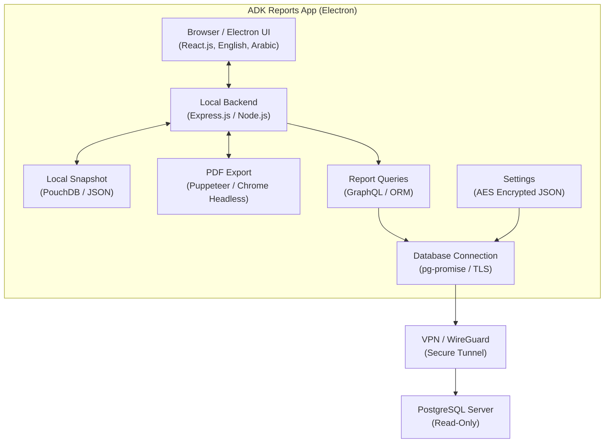

# JavaScript Technologies (Electron & Node.js)

This alternative is built entirely around the JavaScript ecosystem and is particularly well-suited for developing cross-platform desktop applications that run on Windows, macOS, and Linux.

## Architecture Diagram

## Technologies Overview

1. **User Interface & Desktop Application (Electron & React.js):** Instead of relying on an external browser and a separate `.exe` file, the React frontend and local backend are bundled together into a single Electron desktop application.

2. **Local Backend (Express.js):** An alternative to FastAPI, responsible for handling application requests and processing them locally.

3. **Secure Connectivity & Remote Database (WireGuard & PostgreSQL):** Instead of using an SSH tunnel and SQL Server, this approach uses a secure virtual private network tunnel (WireGuard) to connect to a powerful, open-source PostgreSQL database.